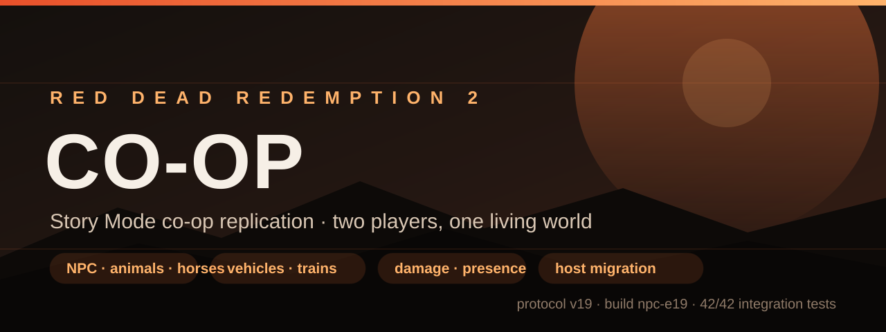
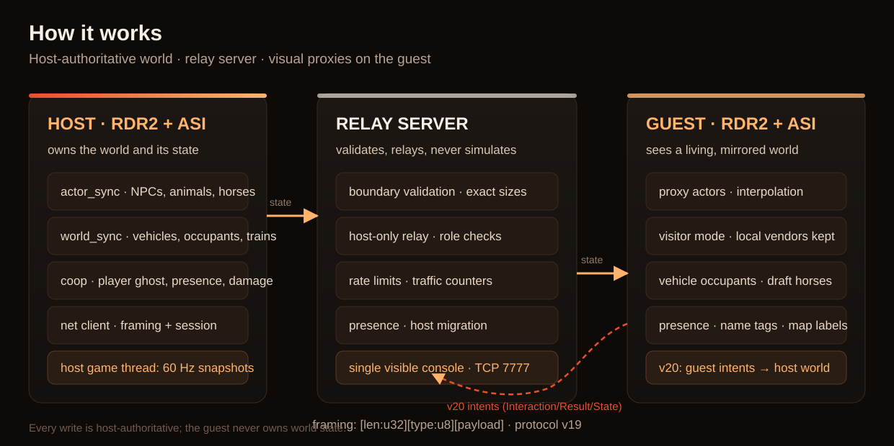
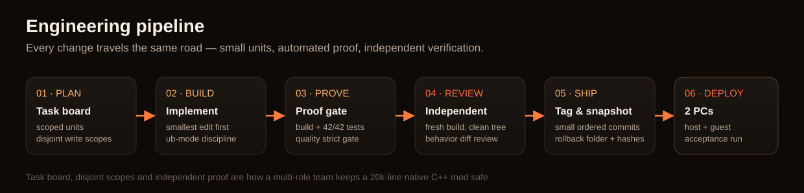

<p align="center">
  
</p>

<h1 align="center">RDR2 Story Mode Co-op</h1>

<p align="center">
  
  
  
  
  
  
  
</p>

<p align="center">
  <a href="README.md">English</a> · <b>Русский</b>
</p>

<p align="center">
  <b><a href="#установка">Установка</a></b>
  ·
  <b><a href="#сборка-из-исходников">Сборка из исходников</a></b>
  ·
  <b><a href="#конфигурация">Конфигурация</a></b>
  ·
  <b><a href="#как-это-работает">Как это работает</a></b>
  ·
  <b><a href="#инженерия-и-качество">Инженерия</a></b>
</p>

**Кооперативный слой репликации для Red Dead Redemption 2 — сюжетный режим.**
Хостовый ПК продолжает играть в свой мир; второй игрок подключается по локальной
сети и видит NPC, животных, лошадей, повозки, поезда, трафик, урон и статусы игрока,
реплицированные в его собственную игровую сессию — плавно, в реальном времени, без
модификации движка игры.

> В сюжетном режиме нет штатного мультиплеера. Проект — **эмуляция через репликацию**:
> хост владеет миром, relay-сервер валидирует и пересылает состояние, гость рисует
> авторитетные прокси. Клиентской симуляции мира у гостя нет.

## Коротко о главном

| | |
| --- | --- |
| Текущая сборка | **`npc-e19`** (ASI `DD0EE210`, сервер `DD9BD9D8`) |
| Версия протокола | **v19**, обе части должны совпадать |
| Билд игры | Red Dead Redemption 2 **1.0.1491.50** + ScriptHookRDR2 |
| Игроки | **хост + гость** (2 игрока на сессию) |
| Интеграционные тесты | **42 / 42** (Python-набор протокола и сервера) |
| C++ тесты | **7 / 7** (frame reader, config, парсинг, mission barrier, бюджеты, fuzz) |
| Гейт качества | **strict pass** — 45 файлов · 505 функций · CRAP>5000 = 3 · TODO = 0 |
| Размер кода | **~29,5 тыс. строк** (~24,6 тыс. кода) C++17 + PowerShell/Python-инструменты |
| Сеть | LAN, TCP `7777`, типично **4–12 КБ/с**, максимум **≤ 15 КБ/с** |
| Статус | `npc-e19` задеплоена на оба ПК; идёт полная 2-ПК приёмка |

## Что умеет

<table>
<tr><td width="50%" valign="top">

**Мир и акторы**
- NPC, фоновые педы и миссионные акторы
- Животные и лошади, включая тягловых
- Внешность людей (компоненты, drawable, tint)
- Внешность животных/лошадей и сбруя
- Сценарии, бой, прицел, перезарядка, оружие
- Урон от гостя, с авторитетом хоста
- Хедшоты убивают (урон считает хост)
- Трупы лежат до 5 минут, «как в оригинале»

</td><td width="50%" valign="top">

**Транспорт и инфраструктура**
- Машины, повозки и их пассажиры
- Водители, пассажиры, тягловые лошади и сбруя
- Миссионные поезда с точными пассажирами по вагонам
- Синхронизация миссионных барьеров, награды и бэкап сейва
- Статусы игрока (карта, пауза, сатчель, магазин)
- Подписи на карте и ники над головой
- Host migration (выход, крэш, зависание игрового потока)
- Снапшоты для отката на каждую сборку

</td></tr>
</table>

## Архитектура

<p align="center">
  
</p>

Три компонента, одна модель авторитета:

| Компонент | Где работает | Ответственность |
| --- | --- | --- |
| **ASI-клиент** (`rdr2_coop.asi`) | оба ПК | хукает игру, находит акторов, снимает состояние, применяет прокси, рисует UI |
| **Relay-сервер** (`rdr2_coop_server.exe`) | ПК хоста (или любой ПК в LAN) | валидирует сообщения на границе, следит за ролями и rate-limit, релеит host-only состояние |
| **Формат снапшотов** | — | `[len:u32][type:u8][payload]`, версионированный протокол |

Хост — единственный писатель состояния мира. Гость отправляет намерения (кадр игрока,
урон, статусы) и рисует авторитетные снапшоты хоста. Сервер ничего не симулирует и
никогда не трогает процесс игры.

## Установка

### Требования

- Red Dead Redemption 2 **1.0.1491.50** (сюжетный режим) на **обоих** ПК
- [ScriptHookRDR2](https://www.dev-c.com/rdr2/scripthookrdr2/) + ASI-загрузчик (`dinput8.dll`)
- Windows 10/11 x64, два ПК в одной локальной сети
- Сервер: без зависимостей (статический CRT)

### 1. Сборка (или готовая пара)

Соберите из исходников (см. [Сборка из исходников](#сборка-из-исходников)) или
возьмите готовый снапшот `dist/npc-*`. В снапшоте ровно:

```
rdr2_coop.asi          # клиентский плагин
rdr2_coop_server.exe   # relay-сервер
rdr2-coop.ini.local    # INI хоста (28 ключей)
rdr2-coop.ini.arina    # шаблон INI гостя
README.md              # хеши, протокол, инструкция отката
```

### 2. Клиент

Скопируйте `rdr2_coop.asi` в папку `scripts` игры на **обоих** ПК:

```
<игра>\scripts\rdr2_coop.asi
```

### 3. Сервер

Сервер запускается на **ПК хоста** в **видимом консольном окне**:

```powershell
rdr2_coop_server.exe 7777
```

Не закрывайте окно — живой лог это основной инструмент диагностики. Сервер раз в
5 секунд печатает состояние игроков, счётчики трафика по типам и liveness хоста.

### 4. Конфигурация обоих ПК

Клиент читает `scripts\rdr2-coop.ini`:

```ini
server_host = 192.168.1.103   ; IP ПК, где запущен сервер
server_port = 7777
player_name = Denuwa
```

Обычно хост использует `127.0.0.1`, гость — LAN-IP хоста. Все 28 ключей описаны
в разделе [Конфигурация](#конфигурация).

### 5. Игра

1. Запустите сервер на ПК хоста.
2. Запустите RDR2 на **хосте** (роль хоста назначает сервер).
3. Запустите RDR2 на **госте**.
4. Играйте сюжет вместе — гость видит мир хоста.

## Сборка из исходников

### ASI-клиент

```powershell
cmake -S . -B build -G "Visual Studio 16 2019" -A x64
cmake --build build --config Release
# -> build\Release\rdr2_coop.asi
```

### Relay-сервер

```powershell
cmake -S server -B build-server -G "Visual Studio 16 2019" -A x64
cmake --build build-server --config Release
# -> build-server\Release\rdr2_coop_server.exe
```

### Тесты и полный proof gate

```powershell
cmake -S tests -B tests\build -G "Visual Studio 16 2019" -A x64
cmake --build tests\build --config Release
powershell -ExecutionPolicy Bypass -File scripts\ci.ps1
```

`scripts/ci.ps1` собирает всё, прогоняет Python-набор интеграции и C++ тесты,
запускает скан качества и включает **строгий гейт** (регрессия по CRAP, дублированию
или количеству TODO валит прогон). Флаги `-NoClient`, `-NoServer`, `-NoTests` —
если нужна только часть пайплайна.

### Снапшоты релизов

Каждая принятая итерация замораживается в самодостаточную папку с хешами и
заметкой об откате:

```powershell
powershell -ExecutionPolicy Bypass -File tools\snapshot_build.ps1 `
  -Label npc-e19 -Protocol 19 -Commit ef49ac8 `
  -Features "..." -Note "..." -Tag npc-e19
```

Снапшоты живут в `dist/<label>/` (в git не коммитятся — это релизные артефакты).
Теги `npc-e0 … npc-e19` фиксируют соответствующие исходники.

## Конфигурация

`rdr2-coop.ini` создаётся при первом запуске. Неизвестные ключи игнорируются,
невалидные числа откатываются к безопасным значениям, `;` и `#` — комментарии.

| Группа | Ключ | По умолчанию | Что значит |
| --- | --- | --- | --- |
| Сеть | `server_host`, `server_port` | `127.0.0.1`, `7777` | адрес relay-сервера |
| Личность | `player_name`, `ped_model` | — | имя игрока и модель сюжетного режима |
| Мир | `world_sync`, `world_vehicles`, `world_trains` | `0`, `1`, `0` | флаг полного мира, транспорт, миссионные поезда |
| Миссии | `mission_sync`, `mission_credit`, `save_backup` | `0`, `0`, `1` | барьер миссий, зачёт наград, бэкап сейва |
| Ядро NPC | `npc_actor`, `npc_cap`, `npc_radius` | `1`, `12`, `60` | репликация, лимит акторов, радиус обнаружения |
| Детали NPC | `npc_appearance`, `npc_animal_cap`, `npc_damage`, `npc_corpse_max_sec` | `1`, `4`, `1`, `300` | внешность, лимит животных, урон, удержание трупов |
| Движение | `npc_motion_update`, `npc_motion_marker`, `npc_motion_status_p2`, `npc_frame_hz`, `npc_frame_adaptive` | `1`, `0`, `1`, `15`, `1` | обновления движения, отладка, частота кадров |
| Visitor mode | `npc_visitor`, `npc_visitor_vehicles`, `npc_visitor_preserve_events`, `npc_visitor_pause_scenes` | `1`, `1`, `1`, `1` | режим мира гостя и сохраняемые локальные NPC |
| Транспорт | `npc_occupants`, `npc_vehicle_radius` | `1`, `80` | occupants/тягловые, радиус сканирования транспорта |
| Игрок | `player_frame_hz`, `player_frame_change_only` | `20`, `1` | частота кадров игрока / отправка только изменений |
| Внешность | `npc_animal_appearance`, `npc_mount_appearance` | `0`, `0` | внешность животных/лошади под всадником |
| Колёса (A/B) | `npc_vehicle_wheels` | `0` | экспериментальный спин колёс прокси |
| Статусы | `npc_presence` | `1` | суффикс статуса в нике |
| Отладка | `npc_debug`, `train_debug` | `1`, `0` | подробные логи акторов/поездов |

Стартовый валидатор печатает `config: warn ...` для опасных комбинаций
(например, `world_sync=1` вместе с `npc_actor=0`).

## Как это работает

- **Обнаружение** — хост сканирует акторов, животных, лошадей и транспорт вокруг
  игрока (по радиусу, с бюджетом на тик) и выдаёт стабильные сетевые ID.
- **Репликация** — хост шлёт батчи спавна, кадры акторов 60 Гц, ассеты внешности,
  наряды, снапшоты транспорта, occupants и состояние поездов. Все интервалы —
  wall-clock, поэтому поведение не зависит от FPS.
- **Интерполяция** — гость сглаживает движение акторов и транспорта между снапшотами
  (lead-based far-target, телепорт только при большом рассинхроне).
- **Visitor mode** — гость подавляет свою фоновую толпу, чтобы не было дублей, но
  оставляет своих продавцов, квестовых и событийных NPC как свой мир.
- **Авторитет** — хост считает урон, смерть, хедшоты, наряды, occupants и миграцию
  хоста. Сервер только валидирует и релеит.
- **Восстановление** — если хост завис или вышел, сервер демотирует его и повышает
  гостя с grace-периодом; если игровой поток молчит во время загрузки, presence-heartbeat
  не даёт ложно сработать таймауту.

Подробные спецификации: [docs/PROTOCOL.md](docs/PROTOCOL.md),
[docs/PERF.md](docs/PERF.md), [docs/TRAINS.md](docs/TRAINS.md),
[docs/NPC_E1_TESTING.md](docs/NPC_E1_TESTING.md).

## Инженерия и качество

<p align="center">
  
</p>

Проект разрабатывается и ревьюится **командой с разделением ролей** по дисциплине
[ub-mode](https://github.com/unclebob/ub-mode): *сначала заставь работать, потом сделай
правильно, затем соблюдай практику*. Каждое изменение — маленькая проверяемая единица
с письменным action log.

| Гейт | Что доказывает |
| --- | --- |
| Сборка | клиент ASI + relay-сервер + тесты собираются чисто (`0 warning / 0 error`) |
| Интеграция | **42/42** тестов протокола/сервера: join race, host migration, rate limits, fuzz |
| C++ тесты | **7/7** детерминированных наборов |
| Качество | строгий гейт CRAP/дублирование/TODO против закоммиченного baseline |
| Независимое ревью | второй агент пересобирает из чистого архива и сверяет поведение |
| Откат | у каждой сборки есть тег исходников и папка снапшота с хешами |

**Метрики качества (текущий baseline):** 45 файлов · 505 функций · CRAP>5000 = **3** ·
дублирование ≥4 = **3** · TODO = **0**. Сканер и baseline — в репозитории:
[tools/quality_scan.py](tools/quality_scan.py), [docs/UB_MODE.md](docs/UB_MODE.md).

### Команда и процесс

| Роль | Ответственность |
| --- | --- |
| **Lead / интегратор** | архитектура, доска задач, сборки, CI, коммиты, теги, деплой, релизные снапшоты |
| **Сеть и протокол** | фрейминг, совместимость провода, server relay, rate limits, host migration |
| **Клиентский геймплей** | C++ пути геймплея, нативы, интерполяция, visitor mode |
| **QA и приёмка** | интеграционные/C++ тесты, гейт качества, чек-листы, документация |
| **Архитектор world-sync** | дизайн репликации, предложения по протоколу, независимый proof каждого среза |
| **Native R&D** | исследование нативов ScriptHookRDR2, сигнатуры, безопасные фолбэки |

Процесс: **план → реализация в непересекающихся scope → proof gate на каждый unit →
независимый proof → маленькие упорядоченные коммиты → тег + снапшот → деплой на оба
ПК**. Доска задач и write scopes фиксируются по каждой задаче; никто не перезаписывает
чужие файлы.

## Производительность

Замерено на 2-ПК LAN-сессии (`npc-e19`, host p95 по 300 кадрам):

| Метрика | Значение | Бюджет |
| --- | --- | --- |
| Полный кадр | p95 **0,39 мс**, max **1,12 мс** | p95 ≤ 4 мс, max ≤ 10 мс |
| World sync | p95 **0,10 мс** | — |
| Actor sync | p95 **0,20 мс** | p95 ≤ 2 мс |
| Coop-логика | p95 **0,16 мс** | — |
| Трафик клиента | **~7,1 КБ/с tx**, **~0,5 КБ/с rx** | типично ≤ 10–12 КБ/с |
| Трафик сервера | типично **4–12 КБ/с**, пики ≤ 15 КБ/с | худший ≤ 15 КБ/с |

Каждая строка лога машиночитаема (`perf: frame`, `perf: net`, `net: ...` на сервере) и
проверяется [tools/perf_report.py](tools/perf_report.py).

## Тестирование и приёмка

- [docs/ACCEPTANCE_2PC.md](docs/ACCEPTANCE_2PC.md) — чек-лист 2-ПК приёмки
  (блоки A–H + блок I по интерактивности в работе), точные хеши и план отката.
- [docs/NPC_E1_TESTING.md](docs/NPC_E1_TESTING.md) — каталог сценариев **S1–S32**
  с ожидаемыми строками лога.
- [docs/TESTING.md](docs/TESTING.md) — стратегия headless-тестов и инструменты.
- [tests/README.md](tests/README.md) — как запускать интеграцию и C++ тесты.
- [tools/README.md](tools/README.md) — снапшоты, деплой, трафик и fake-клиенты.

## Дорожная карта

| Фаза | Статус | Что входит |
| --- | --- | --- |
| E1–E5 | готово | акторы, движение, внешность, урон, трупы |
| E6–E8 | готово | presence, полировка движения, host migration / счётчики трафика |
| E9–E11 | готово | внешность животных/лошадей, наряд под всадником, точные пассажиры поездов |
| E12–E15 | готово | перф-кадр, throttle кадров игрока, учёт трафика, ub-mode рефакторинги |
| E16–E19 | готово | инструменты качества, мягкая миграция хоста, loading-heartbeat, vendor-dedupe, occupants повозок, подписи на карте, wheel A/B |
| **v20 P1** | в работе | **влияние гостя**: урон, двери, места, угон, привязь лошадей — host-authoritative интенты (`0x23/0x24/0x26`) |

Подробнее: [ROADMAP.md](ROADMAP.md), [docs/INTERACTIVITY.md](docs/INTERACTIVITY.md),
[docs/INTERACTIVITY_P1.md](docs/INTERACTIVITY_P1.md),
[docs/NATIVE_RESEARCH_INTERACT.md](docs/NATIVE_RESEARCH_INTERACT.md).

## Ограничения

- Это **репликация, а не нативный мультиплеерный движок**. Скрипты и миссии сюжетного
  режима остаются host-driven; гость — посетитель в мире хоста.
- Часть host-only сущностей намеренно не реплицируется (миссионные скрипты; локальные
  продавцы сохраняются у гостя by design).
- Транспорт-прокси у гостя визуальный до выхода v20 P1 с host-authoritative
  интерактивностью; спин колёс — опциональный A/B-флаг.
- Поезда — репликация миссионных составов, а не полная симуляция железной дороги.
- Обе части должны работать на **одной версии протокола**; смешение v19/v20 будет
  отклонено.
- Лицензионный файл пока не добавлен: репозиторий считается source-available, перед
  распространением свяжитесь с автором.

## Структура репозитория

| Путь | Что внутри |
| --- | --- |
| `src/` | ASI-клиент: `coop.cpp`, `actor_sync.cpp`, `world_sync.cpp`, нативы, конфиг |
| `net/` | протокол, фрейминг, сокеты, парсер/диспетчер клиента |
| `server/` | relay-сервер (валидация, relay, rate limits, миграция) |
| `tests/` | Python-интеграция и C++ unit/fuzz тесты |
| `tools/` | снапшоты, сканер качества, отчёты трафика/перфа, fake-клиенты |
| `docs/` | протокол, производительность, приёмка, интерактивность и R&D |
| `scripts/ci.ps1` | полный proof gate (сборка + тесты + качество) |
| `assets/` | баннер README, схема архитектуры и пайплайна |

## Благодарности

- [ScriptHookRDR2](https://www.dev-c.com/rdr2/scripthookrdr2/) и сообществу моддинга
  RDR2 — за нативы и инструменты.
- [unclebob/ub-mode](https://github.com/unclebob/ub-mode) — за инженерную дисциплину
  команды.
- Всем, кто присылал симптомы с реальных 2-ПК сессий — каждый фикс в истории начинался
  со строки лога живого плейтеста.

---

<p align="center">
  <sub>Сделано для экспериментов с кооперативом в сюжетном режиме. Не связано с Rockstar Games или Take-Two Interactive.</sub>
</p>
